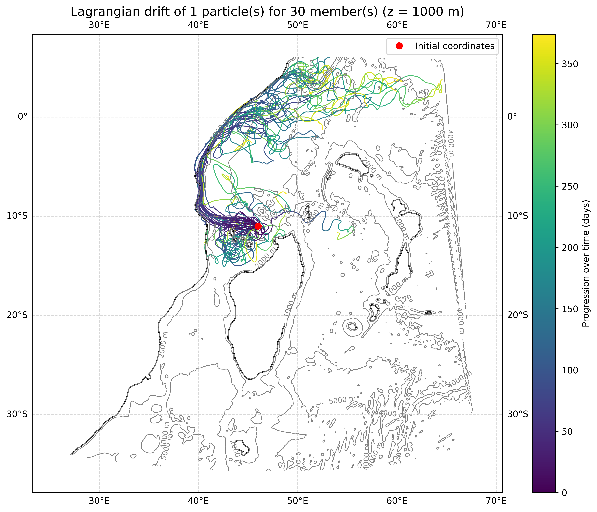
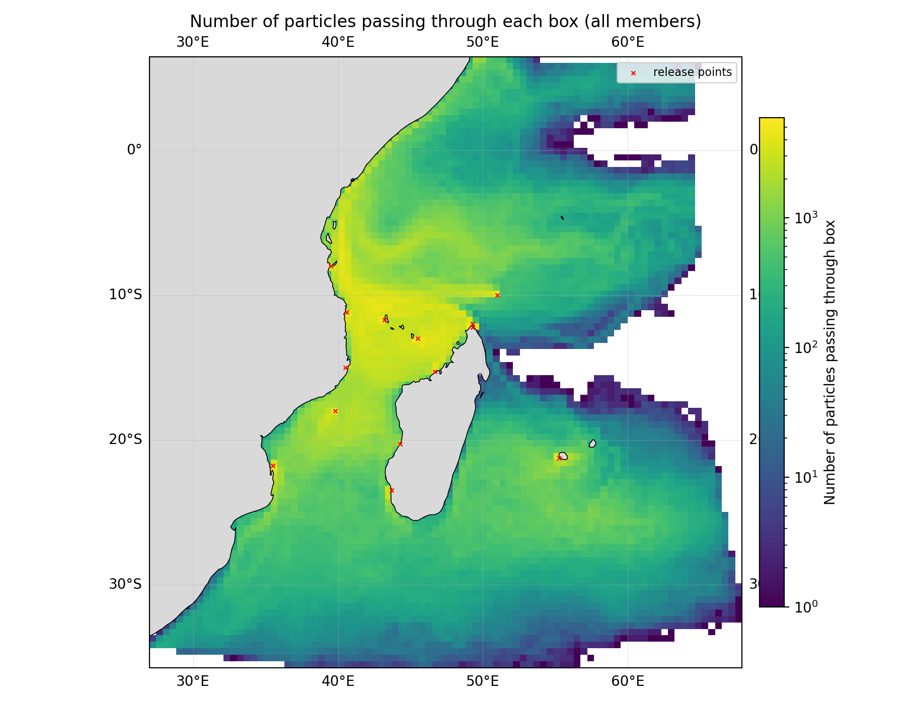

# A simple framework for ensemble lagrangian connectivity modelling and postprocessing

This preliminary work aims at providing useful tests on lagrangian modelling tools that take ocean circulation runs as inputs, within the [BRIDGES-AVATAR](https://www.bridges-wio.com/fr/projet/pc-3-avatar/) research project workframe. The idea is to provide a "starter" set of tools to explore the outputs of chosen simulations, and get used to the associated Lagrangian post-pocessing methods.

**Fig.1: Example of particle drifting from the Glorioso archipelago, starting on Jan 1st 2019, depth 1000m (30 particles on a 30-member ensemble simulation, one particle on each member).**

**Fig.1: Example of a particle density map made from a parcels simulation on a CROCO ensemble run.**

## CONTEXT, BACKGROUND AND OBJECTIVES

In the BRIDGES-AVATAR workframe, we take the SouthWest Indian Ocean (SWIO) as a testbed. This repository standing as a starting point, we made tests on the SWIOSE (SouthWest Indian Ocean Stochastic Ensembles), developed by Lisa Weiss and Jean-Michel Brankart in the [MEOM team, IGE, Grenoble](https://meom-group.github.io/). The goal is to assess the importance of several sources of uncertainty that affect the surface circulation variability in the SWIO region, in anticipation of the MARIO cruise to be conducted in 2028. 

## INSTALLATION INSTRUCTIONS

### OceanParcels

There is a wide offer of lagrangian free, open-source software, but we chose to use the [OceanParcels](https://parcels-code.org/) simulator. The main reason is that it is distributed as a free python module, which makes it very easy to install, set up and customize for any personnal experiment. One inconvenient might be its slower computational time when compared to other simulators, due to the language architecture; However it is quite easy to make it perform parallel and custom computing on clusters. You can create your own parcels installation by following [this tutorial.](https://docs.parcels-code.org/en/latest/installation.html). If you want to reproduce the exact same environment used in this study, go on to the next section.

### Programming environment

To perform our Lagrangian simulations, we used the cluster Adastra, managed by CINES (Centre Informatique National de l'Enseignement Supérieur). Due to compatibility reasons, we used 2 different python virtual environments :

 - The **runlag** venv environment for the Lagrangian computing,
 - The **plothon** conda environment for the connectivity post-processing.

To install the whole toolset on your cluster, just follow these steps :

1) unzip the the repo in your destination directory and go to the env directory,
2) execute create_parcels_venv.sh,
3) execute build_craympi_parcels.sh,
4) install the plothon environment with conda, micromamba or venv with the plothon.yml configuration file.

However, you may just want to use the post-processing scripts from your own Lagrangian outputs. In this case, please proceed as follows :

1) unzip the the repo in your destination directory and go to the env directory,
2) install the plothon environment with conda, micromamba or venv with the plothon.yml configuration file.
   
The post-processing scripts should run properly on any machine (local or distant), as long as you have .zarr lagrangian outputs. If this is not the case, feel free to open an issue on this repository.

### Other optionnal (but useful) tools

+ **[VirtualFleet:](https://github.com/euroargodev/VirtualFleet)** a free, open-source set of python classes and routines, developed on top of OceanParcels, to mimick the behavior and deployment strategies of ARGO floats.
+ **[zarr2netcdf:](https://github.com/daanreijnders/zarr2netcdf)** a free, open-source python protocol to convert .zarr data stores (used by default in parcels and its derivatives) to netcdf files. This can be very convenient for data compression, long-term storage, transfer and sharing.

## USER GUIDE 

### Sources

To start using the toolset, go to the src directory. You should find the following files :

**INPUT SHAPING**

+ **[getvars_swiose.py:](https://github.com/TinoBELLAYER/BRIDGES-AVATAR-lagrangian/blob/main/getvars_swiose.py)** extracts specific variables from the input simulations, i.e. ssh or bathymetry, to visualize them alongside OceanParcels outputs.
  
**LAGRANGIAN SIMULATION**

+ **[runseq_swiose.py:](https://github.com/TinoBELLAYER/BRIDGES-AVATAR-lagrangian/blob/main/runseq_swiose.py)** computes lagrangian trajectories with ocean parcels, using SWIOSE CROCO ensemble outputs.
+ **[runpar_swiose_opt.py:](https://github.com/TinoBELLAYER/BRIDGES-AVATAR-lagrangian/blob/main/runpar_swiose_opt.py)** computes lagrangian trajectories with ocean parcels and an MPI parallelization, using SWIOSE CROCO ensemble outputs.
+ **[slurm_parcels.sh:](https://github.com/TinoBELLAYER/BRIDGES-AVATAR-lagrangian/blob/main/slurm_parcels.sh)** submits runpar_swiose_opt.py as a batch job on a cluster which can perform intensive parallel computing on a cluster that uses the SLURM job manager (here Adastra, operated by the CINES).
  
**LAGRANGIAN VISUALIZATION**

+ **[visu_swiose.py:](https://github.com/TinoBELLAYER/BRIDGES-AVATAR-lagrangian/blob/main/visu_swiose.py)** produces figures to visualize *runseq_swiose.py* outputs.

**CONNECTIVITY PROCESSING**

+ **[count_particles_per_box.py:](https://github.com/TinoBELLAYER/BRIDGES-AVATAR-lagrangian/blob/main/count_particles_per_box.py)** produces a bunch of connectivity metrics from lagrangian trajectories (particle density grid, in-degree matrix, betweenness) and saves it to a netCDF file.

**CONNECTIVITY POSTPROCESSING**

+ **[plot_box_particle_counts.py:](https://github.com/TinoBELLAYER/BRIDGES-AVATAR-lagrangian/blob/main/plot_box_particle_counts.py)** produces figures to visualize *count_particles_per_box.py* outputs.
    
**ROUTINES**

+ **[tools.py:](https://github.com/TinoBELLAYER/BRIDGES-AVATAR-lagrangian/blob/main/tools.py)** a set of functions to perform some specific tasks involved in this work, such as particle generation, and specific visualization.
